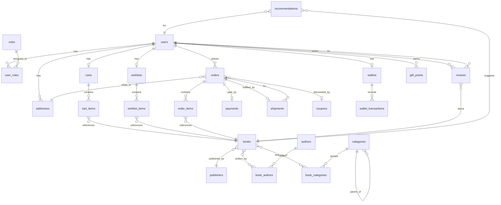

# eCommerce Bookstore — Physical Data Model
> Generated via Prompt 3 | PostgreSQL 15+, 3NF, UUID PKs, Audit Columns, Soft Delete, Optimistic Locking

---

## 1. Design Principles

- **Normal Form:** Third Normal Form (3NF) — no transitive dependencies
- **Primary Keys:** UUID v4 (`gen_random_uuid()`) on all tables
- **Audit Columns:** `created_at`, `created_by`, `updated_at`, `updated_by` on all tables
- **Soft Delete:** `is_deleted BOOLEAN DEFAULT FALSE` on all tables
- **Optimistic Locking:** `version INTEGER DEFAULT 0` on all aggregate roots
- **Timestamps:** `TIMESTAMPTZ` for all datetime columns (timezone-aware)
- **Money:** `NUMERIC(12,2)` for all monetary values
- **Enums:** Stored as `VARCHAR` with CHECK constraints for portability

---

## 2. Entity Relationship Diagram

---

## 3. Tables

---

### 3.1 IAM — Identity & Access

#### `users`
| Column         | Type           | Constraints                          | Notes                        |
|----------------|----------------|--------------------------------------|------------------------------|
| id             | UUID           | PK, DEFAULT gen_random_uuid()        |                              |
| email          | VARCHAR(255)   | NOT NULL, UNIQUE                     |                              |
| password_hash  | VARCHAR(255)   | NOT NULL                             | bcrypt hash                  |
| first_name     | VARCHAR(100)   | NOT NULL                             |                              |
| last_name      | VARCHAR(100)   | NOT NULL                             |                              |
| phone          | VARCHAR(20)    |                                      |                              |
| is_active      | BOOLEAN        | NOT NULL, DEFAULT TRUE               |                              |
| version        | INTEGER        | NOT NULL, DEFAULT 0                  | Optimistic lock              |
| created_at     | TIMESTAMPTZ    | NOT NULL, DEFAULT now()              |                              |
| created_by     | VARCHAR(100)   | NOT NULL, DEFAULT 'system'           |                              |
| updated_at     | TIMESTAMPTZ    | NOT NULL, DEFAULT now()              |                              |
| updated_by     | VARCHAR(100)   | NOT NULL, DEFAULT 'system'           |                              |
| is_deleted     | BOOLEAN        | NOT NULL, DEFAULT FALSE              |                              |

**Indexes:** `idx_users_email` on `email`

---

#### `roles`
| Column     | Type         | Constraints                   | Notes                   |
|------------|--------------|-------------------------------|-------------------------|
| id         | UUID         | PK, DEFAULT gen_random_uuid() |                         |
| name       | VARCHAR(50)  | NOT NULL, UNIQUE              | GUEST, CUSTOMER, ADMIN  |
| created_at | TIMESTAMPTZ  | NOT NULL, DEFAULT now()       |                         |
| created_by | VARCHAR(100) | NOT NULL, DEFAULT 'system'    |                         |
| updated_at | TIMESTAMPTZ  | NOT NULL, DEFAULT now()       |                         |
| updated_by | VARCHAR(100) | NOT NULL, DEFAULT 'system'    |                         |
| is_deleted | BOOLEAN      | NOT NULL, DEFAULT FALSE       |                         |

---

#### `user_roles`
| Column     | Type         | Constraints                          |
|------------|--------------|--------------------------------------|
| id         | UUID         | PK, DEFAULT gen_random_uuid()        |
| user_id    | UUID         | NOT NULL, FK → users(id)             |
| role_id    | UUID         | NOT NULL, FK → roles(id)             |
| created_at | TIMESTAMPTZ  | NOT NULL, DEFAULT now()              |
| created_by | VARCHAR(100) | NOT NULL, DEFAULT 'system'           |
| updated_at | TIMESTAMPTZ  | NOT NULL, DEFAULT now()              |
| updated_by | VARCHAR(100) | NOT NULL, DEFAULT 'system'           |
| is_deleted | BOOLEAN      | NOT NULL, DEFAULT FALSE              |

**Unique Constraint:** `uq_user_roles` on `(user_id, role_id)`

---

#### `addresses`
| Column       | Type         | Constraints                   | Notes                     |
|--------------|--------------|-------------------------------|---------------------------|
| id           | UUID         | PK, DEFAULT gen_random_uuid() |                           |
| user_id      | UUID         | NOT NULL, FK → users(id)      |                           |
| label        | VARCHAR(50)  |                               | e.g. Home, Work           |
| line1        | VARCHAR(255) | NOT NULL                      |                           |
| line2        | VARCHAR(255) |                               |                           |
| city         | VARCHAR(100) | NOT NULL                      |                           |
| state        | VARCHAR(100) | NOT NULL                      |                           |
| country      | VARCHAR(100) | NOT NULL                      |                           |
| pincode      | VARCHAR(20)  | NOT NULL                      |                           |
| is_default   | BOOLEAN      | NOT NULL, DEFAULT FALSE       |                           |
| version      | INTEGER      | NOT NULL, DEFAULT 0           |                           |
| created_at   | TIMESTAMPTZ  | NOT NULL, DEFAULT now()       |                           |
| created_by   | VARCHAR(100) | NOT NULL, DEFAULT 'system'    |                           |
| updated_at   | TIMESTAMPTZ  | NOT NULL, DEFAULT now()       |                           |
| updated_by   | VARCHAR(100) | NOT NULL, DEFAULT 'system'    |                           |
| is_deleted   | BOOLEAN      | NOT NULL, DEFAULT FALSE       |                           |

**Indexes:** `idx_addresses_user_id` on `user_id`

---

### 3.2 Catalog

#### `publishers`
| Column      | Type         | Constraints                   |
|-------------|--------------|-------------------------------|
| id          | UUID         | PK, DEFAULT gen_random_uuid() |
| name        | VARCHAR(255) | NOT NULL, UNIQUE              |
| country     | VARCHAR(100) |                               |
| website_url | VARCHAR(500) |                               |
| created_at  | TIMESTAMPTZ  | NOT NULL, DEFAULT now()       |
| created_by  | VARCHAR(100) | NOT NULL, DEFAULT 'system'    |
| updated_at  | TIMESTAMPTZ  | NOT NULL, DEFAULT now()       |
| updated_by  | VARCHAR(100) | NOT NULL, DEFAULT 'system'    |
| is_deleted  | BOOLEAN      | NOT NULL, DEFAULT FALSE       |

---

#### `authors`
| Column            | Type         | Constraints                   |
|-------------------|--------------|-------------------------------|
| id                | UUID         | PK, DEFAULT gen_random_uuid() |
| first_name        | VARCHAR(100) | NOT NULL                      |
| last_name         | VARCHAR(100) | NOT NULL                      |
| bio               | TEXT         |                               |
| profile_image_url | VARCHAR(500) |                               |
| created_at        | TIMESTAMPTZ  | NOT NULL, DEFAULT now()       |
| created_by        | VARCHAR(100) | NOT NULL, DEFAULT 'system'    |
| updated_at        | TIMESTAMPTZ  | NOT NULL, DEFAULT now()       |
| updated_by        | VARCHAR(100) | NOT NULL, DEFAULT 'system'    |
| is_deleted        | BOOLEAN      | NOT NULL, DEFAULT FALSE       |

---

#### `categories`
| Column           | Type         | Constraints                      | Notes               |
|------------------|--------------|----------------------------------|---------------------|
| id               | UUID         | PK, DEFAULT gen_random_uuid()    |                     |
| name             | VARCHAR(100) | NOT NULL                         |                     |
| slug             | VARCHAR(100) | NOT NULL, UNIQUE                 |                     |
| parent_id        | UUID         | FK → categories(id), NULLABLE    | Self-referential    |
| display_order    | INTEGER      | NOT NULL, DEFAULT 0              |                     |
| created_at       | TIMESTAMPTZ  | NOT NULL, DEFAULT now()          |                     |
| created_by       | VARCHAR(100) | NOT NULL, DEFAULT 'system'       |                     |
| updated_at       | TIMESTAMPTZ  | NOT NULL, DEFAULT now()          |                     |
| updated_by       | VARCHAR(100) | NOT NULL, DEFAULT 'system'       |                     |
| is_deleted       | BOOLEAN      | NOT NULL, DEFAULT FALSE          |                     |

---

#### `books`
| Column             | Type           | Constraints                      | Notes                     |
|--------------------|----------------|----------------------------------|---------------------------|
| id                 | UUID           | PK, DEFAULT gen_random_uuid()    |                           |
| title              | VARCHAR(500)   | NOT NULL                         |                           |
| isbn               | VARCHAR(20)    | NOT NULL, UNIQUE                 | ISBN-13                   |
| publisher_id       | UUID           | NOT NULL, FK → publishers(id)    |                           |
| description        | TEXT           |                                  |                           |
| price              | NUMERIC(12,2)  | NOT NULL, CHECK (price >= 0)     |                           |
| stock_quantity     | INTEGER        | NOT NULL, DEFAULT 0              |                           |
| cover_image_url    | VARCHAR(500)   |                                  |                           |
| language           | VARCHAR(50)    | NOT NULL, DEFAULT 'English'      |                           |
| pages              | INTEGER        |                                  |                           |
| published_date     | DATE           |                                  |                           |
| delivery_days      | INTEGER        | NOT NULL, DEFAULT 5              | Tentative delivery window |
| average_rating     | NUMERIC(3,2)   | DEFAULT 0.00                     | Denormalised for reads    |
| review_count       | INTEGER        | DEFAULT 0                        | Denormalised for reads    |
| is_active          | BOOLEAN        | NOT NULL, DEFAULT TRUE           |                           |
| version            | INTEGER        | NOT NULL, DEFAULT 0              |                           |
| created_at         | TIMESTAMPTZ    | NOT NULL, DEFAULT now()          |                           |
| created_by         | VARCHAR(100)   | NOT NULL, DEFAULT 'system'       |                           |
| updated_at         | TIMESTAMPTZ    | NOT NULL, DEFAULT now()          |                           |
| updated_by         | VARCHAR(100)   | NOT NULL, DEFAULT 'system'       |                           |
| is_deleted         | BOOLEAN        | NOT NULL, DEFAULT FALSE          |                           |

**Indexes:**
- `idx_books_isbn` on `isbn`
- `idx_books_publisher_id` on `publisher_id`
- `idx_books_title_fts` — GIN index on `to_tsvector('english', title)` for full-text search

---

#### `book_authors`
| Column     | Type         | Constraints                   |
|------------|--------------|-------------------------------|
| id         | UUID         | PK, DEFAULT gen_random_uuid() |
| book_id    | UUID         | NOT NULL, FK → books(id)      |
| author_id  | UUID         | NOT NULL, FK → authors(id)    |
| created_at | TIMESTAMPTZ  | NOT NULL, DEFAULT now()       |
| created_by | VARCHAR(100) | NOT NULL, DEFAULT 'system'    |
| updated_at | TIMESTAMPTZ  | NOT NULL, DEFAULT now()       |
| updated_by | VARCHAR(100) | NOT NULL, DEFAULT 'system'    |
| is_deleted | BOOLEAN      | NOT NULL, DEFAULT FALSE       |

**Unique Constraint:** `uq_book_authors` on `(book_id, author_id)`

---

#### `book_categories`
| Column      | Type         | Constraints                    |
|-------------|--------------|--------------------------------|
| id          | UUID         | PK, DEFAULT gen_random_uuid()  |
| book_id     | UUID         | NOT NULL, FK → books(id)       |
| category_id | UUID         | NOT NULL, FK → categories(id)  |
| created_at  | TIMESTAMPTZ  | NOT NULL, DEFAULT now()        |
| created_by  | VARCHAR(100) | NOT NULL, DEFAULT 'system'     |
| updated_at  | TIMESTAMPTZ  | NOT NULL, DEFAULT now()        |
| updated_by  | VARCHAR(100) | NOT NULL, DEFAULT 'system'     |
| is_deleted  | BOOLEAN      | NOT NULL, DEFAULT FALSE        |

**Unique Constraint:** `uq_book_categories` on `(book_id, category_id)`

---

### 3.3 Shopping

#### `carts`
| Column     | Type         | Constraints                                                      |
|------------|--------------|------------------------------------------------------------------|
| id         | UUID         | PK, DEFAULT gen_random_uuid()                                    |
| user_id    | UUID         | NOT NULL, FK → users(id)                                         |
| status     | VARCHAR(20)  | NOT NULL, DEFAULT 'ACTIVE', CHECK IN ('ACTIVE','CHECKED_OUT','ABANDONED') |
| version    | INTEGER      | NOT NULL, DEFAULT 0                                              |
| created_at | TIMESTAMPTZ  | NOT NULL, DEFAULT now()                                          |
| created_by | VARCHAR(100) | NOT NULL, DEFAULT 'system'                                       |
| updated_at | TIMESTAMPTZ  | NOT NULL, DEFAULT now()                                          |
| updated_by | VARCHAR(100) | NOT NULL, DEFAULT 'system'                                       |
| is_deleted | BOOLEAN      | NOT NULL, DEFAULT FALSE                                          |

**Indexes:** `idx_carts_user_id` on `user_id`

---

#### `cart_items`
| Column     | Type          | Constraints                          |
|------------|---------------|--------------------------------------|
| id         | UUID          | PK, DEFAULT gen_random_uuid()        |
| cart_id    | UUID          | NOT NULL, FK → carts(id)             |
| book_id    | UUID          | NOT NULL, FK → books(id)             |
| quantity   | INTEGER       | NOT NULL, CHECK (quantity > 0)       |
| unit_price | NUMERIC(12,2) | NOT NULL                             |
| created_at | TIMESTAMPTZ   | NOT NULL, DEFAULT now()              |
| created_by | VARCHAR(100)  | NOT NULL, DEFAULT 'system'           |
| updated_at | TIMESTAMPTZ   | NOT NULL, DEFAULT now()              |
| updated_by | VARCHAR(100)  | NOT NULL, DEFAULT 'system'           |
| is_deleted | BOOLEAN       | NOT NULL, DEFAULT FALSE              |

**Unique Constraint:** `uq_cart_items` on `(cart_id, book_id)`

---

#### `wishlists`
| Column     | Type         | Constraints                   |
|------------|--------------|-------------------------------|
| id         | UUID         | PK, DEFAULT gen_random_uuid() |
| user_id    | UUID         | NOT NULL, UNIQUE, FK → users(id) |
| created_at | TIMESTAMPTZ  | NOT NULL, DEFAULT now()       |
| created_by | VARCHAR(100) | NOT NULL, DEFAULT 'system'    |
| updated_at | TIMESTAMPTZ  | NOT NULL, DEFAULT now()       |
| updated_by | VARCHAR(100) | NOT NULL, DEFAULT 'system'    |
| is_deleted | BOOLEAN      | NOT NULL, DEFAULT FALSE       |

---

#### `wishlist_items`
| Column      | Type         | Constraints                    |
|-------------|--------------|--------------------------------|
| id          | UUID         | PK, DEFAULT gen_random_uuid()  |
| wishlist_id | UUID         | NOT NULL, FK → wishlists(id)   |
| book_id     | UUID         | NOT NULL, FK → books(id)       |
| created_at  | TIMESTAMPTZ  | NOT NULL, DEFAULT now()        |
| created_by  | VARCHAR(100) | NOT NULL, DEFAULT 'system'     |
| updated_at  | TIMESTAMPTZ  | NOT NULL, DEFAULT now()        |
| updated_by  | VARCHAR(100) | NOT NULL, DEFAULT 'system'     |
| is_deleted  | BOOLEAN      | NOT NULL, DEFAULT FALSE        |

**Unique Constraint:** `uq_wishlist_items` on `(wishlist_id, book_id)`

---

### 3.4 Orders

#### `orders`
| Column           | Type          | Constraints                                                                        |
|------------------|---------------|------------------------------------------------------------------------------------|
| id               | UUID          | PK, DEFAULT gen_random_uuid()                                                      |
| user_id          | UUID          | NOT NULL, FK → users(id)                                                           |
| address_id       | UUID          | NOT NULL, FK → addresses(id)                                                       |
| coupon_id        | UUID          | FK → coupons(id), NULLABLE                                                         |
| status           | VARCHAR(20)   | NOT NULL, DEFAULT 'PENDING', CHECK IN ('PENDING','CONFIRMED','SHIPPED','DELIVERED','CANCELLED','RETURNED') |
| subtotal         | NUMERIC(12,2) | NOT NULL                                                                           |
| discount_amount  | NUMERIC(12,2) | NOT NULL, DEFAULT 0.00                                                             |
| shipping_cost    | NUMERIC(12,2) | NOT NULL, DEFAULT 0.00                                                             |
| total_amount     | NUMERIC(12,2) | NOT NULL                                                                           |
| gift_points_used | INTEGER       | NOT NULL, DEFAULT 0                                                                |
| placed_at        | TIMESTAMPTZ   | NOT NULL, DEFAULT now()                                                            |
| cancel_deadline  | TIMESTAMPTZ   |                                                                                    |
| notes            | TEXT          |                                                                                    |
| version          | INTEGER       | NOT NULL, DEFAULT 0                                                                |
| created_at       | TIMESTAMPTZ   | NOT NULL, DEFAULT now()                                                            |
| created_by       | VARCHAR(100)  | NOT NULL, DEFAULT 'system'                                                         |
| updated_at       | TIMESTAMPTZ   | NOT NULL, DEFAULT now()                                                            |
| updated_by       | VARCHAR(100)  | NOT NULL, DEFAULT 'system'                                                         |
| is_deleted       | BOOLEAN       | NOT NULL, DEFAULT FALSE                                                            |

**Indexes:** `idx_orders_user_id` on `user_id`, `idx_orders_status` on `status`

---

#### `order_items`
| Column            | Type          | Constraints                   |
|-------------------|---------------|-------------------------------|
| id                | UUID          | PK, DEFAULT gen_random_uuid() |
| order_id          | UUID          | NOT NULL, FK → orders(id)     |
| book_id           | UUID          | NOT NULL, FK → books(id)      |
| quantity          | INTEGER       | NOT NULL, CHECK (quantity > 0)|
| unit_price        | NUMERIC(12,2) | NOT NULL                      |
| estimated_delivery| DATE          |                               |
| created_at        | TIMESTAMPTZ   | NOT NULL, DEFAULT now()       |
| created_by        | VARCHAR(100)  | NOT NULL, DEFAULT 'system'    |
| updated_at        | TIMESTAMPTZ   | NOT NULL, DEFAULT now()       |
| updated_by        | VARCHAR(100)  | NOT NULL, DEFAULT 'system'    |
| is_deleted        | BOOLEAN       | NOT NULL, DEFAULT FALSE       |

---

### 3.5 Payments

#### `payments`
| Column          | Type          | Constraints                                                                   |
|-----------------|---------------|-------------------------------------------------------------------------------|
| id              | UUID          | PK, DEFAULT gen_random_uuid()                                                 |
| order_id        | UUID          | NOT NULL, UNIQUE, FK → orders(id)                                             |
| method          | VARCHAR(30)   | NOT NULL, CHECK IN ('CREDIT_CARD','DEBIT_CARD','WALLET','GIFT_CARD','POINTS') |
| status          | VARCHAR(20)   | NOT NULL, DEFAULT 'INITIATED', CHECK IN ('INITIATED','SUCCESS','FAILED','REFUNDED') |
| amount          | NUMERIC(12,2) | NOT NULL                                                                      |
| transaction_ref | VARCHAR(255)  |                                                                               |
| gateway_response| TEXT          |                                                                               |
| paid_at         | TIMESTAMPTZ   |                                                                               |
| refunded_at     | TIMESTAMPTZ   |                                                                               |
| version         | INTEGER       | NOT NULL, DEFAULT 0                                                           |
| created_at      | TIMESTAMPTZ   | NOT NULL, DEFAULT now()                                                       |
| created_by      | VARCHAR(100)  | NOT NULL, DEFAULT 'system'                                                    |
| updated_at      | TIMESTAMPTZ   | NOT NULL, DEFAULT now()                                                       |
| updated_by      | VARCHAR(100)  | NOT NULL, DEFAULT 'system'                                                    |
| is_deleted      | BOOLEAN       | NOT NULL, DEFAULT FALSE                                                       |

---

#### `wallets`
| Column     | Type          | Constraints                   |
|------------|---------------|-------------------------------|
| id         | UUID          | PK, DEFAULT gen_random_uuid() |
| user_id    | UUID          | NOT NULL, UNIQUE, FK → users(id) |
| balance    | NUMERIC(12,2) | NOT NULL, DEFAULT 0.00, CHECK (balance >= 0) |
| version    | INTEGER       | NOT NULL, DEFAULT 0           |
| created_at | TIMESTAMPTZ   | NOT NULL, DEFAULT now()       |
| created_by | VARCHAR(100)  | NOT NULL, DEFAULT 'system'    |
| updated_at | TIMESTAMPTZ   | NOT NULL, DEFAULT now()       |
| updated_by | VARCHAR(100)  | NOT NULL, DEFAULT 'system'    |
| is_deleted | BOOLEAN       | NOT NULL, DEFAULT FALSE       |

---

#### `wallet_transactions`
| Column       | Type          | Constraints                                            |
|--------------|---------------|--------------------------------------------------------|
| id           | UUID          | PK, DEFAULT gen_random_uuid()                          |
| wallet_id    | UUID          | NOT NULL, FK → wallets(id)                             |
| type         | VARCHAR(10)   | NOT NULL, CHECK IN ('CREDIT', 'DEBIT')                 |
| amount       | NUMERIC(12,2) | NOT NULL, CHECK (amount > 0)                           |
| reference_id | UUID          |                                                        |
| description  | VARCHAR(255)  |                                                        |
| created_at   | TIMESTAMPTZ   | NOT NULL, DEFAULT now()                                |
| created_by   | VARCHAR(100)  | NOT NULL, DEFAULT 'system'                             |
| updated_at   | TIMESTAMPTZ   | NOT NULL, DEFAULT now()                                |
| updated_by   | VARCHAR(100)  | NOT NULL, DEFAULT 'system'                             |
| is_deleted   | BOOLEAN       | NOT NULL, DEFAULT FALSE                                |

---

### 3.6 Shipping

#### `shipments`
| Column             | Type         | Constraints                                                                       |
|--------------------|--------------|-----------------------------------------------------------------------------------|
| id                 | UUID         | PK, DEFAULT gen_random_uuid()                                                     |
| order_id           | UUID         | NOT NULL, UNIQUE, FK → orders(id)                                                 |
| carrier            | VARCHAR(100) |                                                                                   |
| tracking_number    | VARCHAR(100) |                                                                                   |
| status             | VARCHAR(20)  | NOT NULL, DEFAULT 'CREATED', CHECK IN ('CREATED','DISPATCHED','IN_TRANSIT','DELIVERED','CANCELLED','RETURNED') |
| estimated_delivery | DATE         |                                                                                   |
| dispatched_at      | TIMESTAMPTZ  |                                                                                   |
| delivered_at       | TIMESTAMPTZ  |                                                                                   |
| version            | INTEGER      | NOT NULL, DEFAULT 0                                                               |
| created_at         | TIMESTAMPTZ  | NOT NULL, DEFAULT now()                                                           |
| created_by         | VARCHAR(100) | NOT NULL, DEFAULT 'system'                                                        |
| updated_at         | TIMESTAMPTZ  | NOT NULL, DEFAULT now()                                                           |
| updated_by         | VARCHAR(100) | NOT NULL, DEFAULT 'system'                                                        |
| is_deleted         | BOOLEAN      | NOT NULL, DEFAULT FALSE                                                           |

---

#### `shipping_rates`
| Column      | Type          | Constraints                   |
|-------------|---------------|-------------------------------|
| id          | UUID          | PK, DEFAULT gen_random_uuid() |
| zone        | VARCHAR(100)  | NOT NULL                      |
| weight_from | NUMERIC(8,3)  | NOT NULL                      |
| weight_to   | NUMERIC(8,3)  | NOT NULL                      |
| rate        | NUMERIC(12,2) | NOT NULL                      |
| created_at  | TIMESTAMPTZ   | NOT NULL, DEFAULT now()       |
| created_by  | VARCHAR(100)  | NOT NULL, DEFAULT 'system'    |
| updated_at  | TIMESTAMPTZ   | NOT NULL, DEFAULT now()       |
| updated_by  | VARCHAR(100)  | NOT NULL, DEFAULT 'system'    |
| is_deleted  | BOOLEAN       | NOT NULL, DEFAULT FALSE       |

---

### 3.7 Promotions

#### `coupons`
| Column           | Type          | Constraints                                         |
|------------------|---------------|-----------------------------------------------------|
| id               | UUID          | PK, DEFAULT gen_random_uuid()                       |
| code             | VARCHAR(50)   | NOT NULL, UNIQUE                                    |
| description      | TEXT          |                                                     |
| discount_type    | VARCHAR(20)   | NOT NULL, CHECK IN ('PERCENTAGE', 'FIXED')          |
| discount_value   | NUMERIC(12,2) | NOT NULL, CHECK (discount_value > 0)                |
| min_order_value  | NUMERIC(12,2) | NOT NULL, DEFAULT 0.00                              |
| max_uses         | INTEGER       |                                                     |
| used_count       | INTEGER       | NOT NULL, DEFAULT 0                                 |
| expires_at       | TIMESTAMPTZ   |                                                     |
| is_active        | BOOLEAN       | NOT NULL, DEFAULT TRUE                              |
| version          | INTEGER       | NOT NULL, DEFAULT 0                                 |
| created_at       | TIMESTAMPTZ   | NOT NULL, DEFAULT now()                             |
| created_by       | VARCHAR(100)  | NOT NULL, DEFAULT 'system'                          |
| updated_at       | TIMESTAMPTZ   | NOT NULL, DEFAULT now()                             |
| updated_by       | VARCHAR(100)  | NOT NULL, DEFAULT 'system'                          |
| is_deleted       | BOOLEAN       | NOT NULL, DEFAULT FALSE                             |

---

#### `gift_points`
| Column     | Type         | Constraints                   |
|------------|--------------|-------------------------------|
| id         | UUID         | PK, DEFAULT gen_random_uuid() |
| user_id    | UUID         | NOT NULL, FK → users(id)      |
| points     | INTEGER      | NOT NULL, DEFAULT 0, CHECK (points >= 0) |
| expires_at | TIMESTAMPTZ  |                               |
| version    | INTEGER      | NOT NULL, DEFAULT 0           |
| created_at | TIMESTAMPTZ  | NOT NULL, DEFAULT now()       |
| created_by | VARCHAR(100) | NOT NULL, DEFAULT 'system'    |
| updated_at | TIMESTAMPTZ  | NOT NULL, DEFAULT now()       |
| updated_by | VARCHAR(100) | NOT NULL, DEFAULT 'system'    |
| is_deleted | BOOLEAN      | NOT NULL, DEFAULT FALSE       |

---

### 3.8 Reviews & Recommendations

#### `reviews`
| Column     | Type         | Constraints                                              |
|------------|--------------|----------------------------------------------------------|
| id         | UUID         | PK, DEFAULT gen_random_uuid()                            |
| user_id    | UUID         | NOT NULL, FK → users(id)                                 |
| book_id    | UUID         | NOT NULL, FK → books(id)                                 |
| rating     | INTEGER      | NOT NULL, CHECK (rating BETWEEN 1 AND 5)                 |
| comment    | TEXT         |                                                          |
| status     | VARCHAR(20)  | NOT NULL, DEFAULT 'PENDING', CHECK IN ('PENDING','APPROVED','REJECTED') |
| version    | INTEGER      | NOT NULL, DEFAULT 0                                      |
| created_at | TIMESTAMPTZ  | NOT NULL, DEFAULT now()                                  |
| created_by | VARCHAR(100) | NOT NULL, DEFAULT 'system'                               |
| updated_at | TIMESTAMPTZ  | NOT NULL, DEFAULT now()                                  |
| updated_by | VARCHAR(100) | NOT NULL, DEFAULT 'system'                               |
| is_deleted | BOOLEAN      | NOT NULL, DEFAULT FALSE                                  |

**Unique Constraint:** `uq_reviews` on `(user_id, book_id)` — one review per user per book
**Indexes:** `idx_reviews_book_id` on `book_id`

---

#### `recommendations`
| Column     | Type         | Constraints                   |
|------------|--------------|-------------------------------|
| id         | UUID         | PK, DEFAULT gen_random_uuid() |
| user_id    | UUID         | NOT NULL, FK → users(id)      |
| book_id    | UUID         | NOT NULL, FK → books(id)      |
| score      | NUMERIC(5,4) | NOT NULL                      |
| reason     | VARCHAR(255) |                               |
| created_at | TIMESTAMPTZ  | NOT NULL, DEFAULT now()       |
| created_by | VARCHAR(100) | NOT NULL, DEFAULT 'system'    |
| updated_at | TIMESTAMPTZ  | NOT NULL, DEFAULT now()       |
| updated_by | VARCHAR(100) | NOT NULL, DEFAULT 'system'    |
| is_deleted | BOOLEAN      | NOT NULL, DEFAULT FALSE       |

**Unique Constraint:** `uq_recommendations` on `(user_id, book_id)`
**Indexes:** `idx_recommendations_user_id` on `user_id`

---

## 4. Summary — Table Count by Domain

| Domain      | Tables                                                                 | Count |
|-------------|------------------------------------------------------------------------|-------|
| IAM         | users, roles, user_roles, addresses                                    | 4     |
| Catalog     | books, authors, publishers, categories, book_authors, book_categories  | 6     |
| Shopping    | carts, cart_items, wishlists, wishlist_items                           | 4     |
| Orders      | orders, order_items                                                    | 2     |
| Payments    | payments, wallets, wallet_transactions                                 | 3     |
| Shipping    | shipments, shipping_rates                                              | 2     |
| Promotions  | coupons, gift_points                                                   | 2     |
| Reviews     | reviews, recommendations                                               | 2     |
| **Total**   |                                                                        | **25**|
