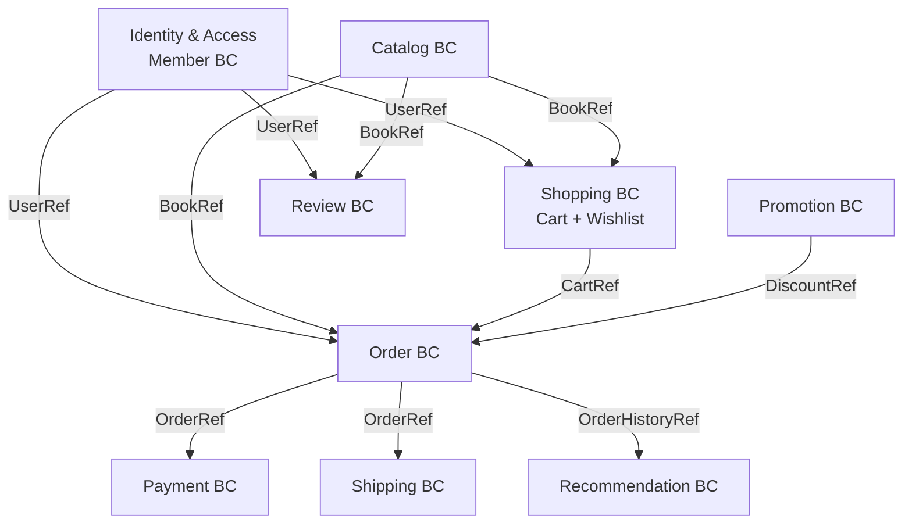
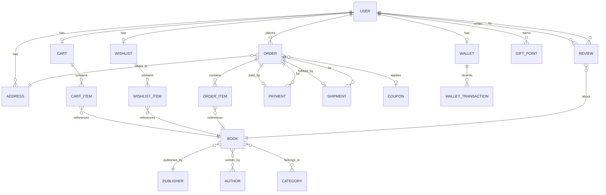
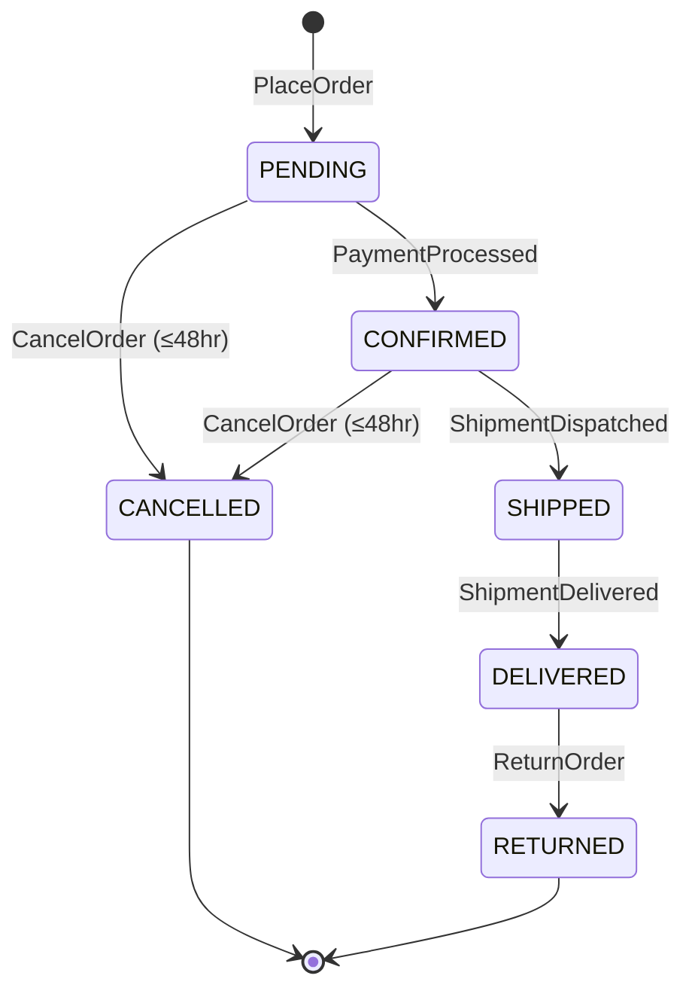
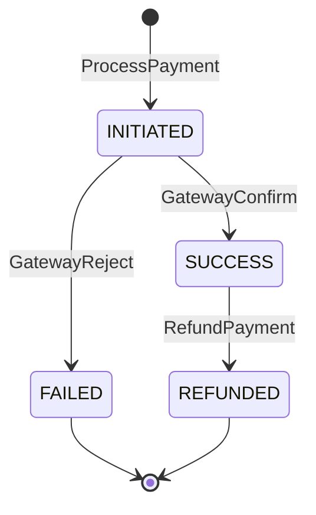
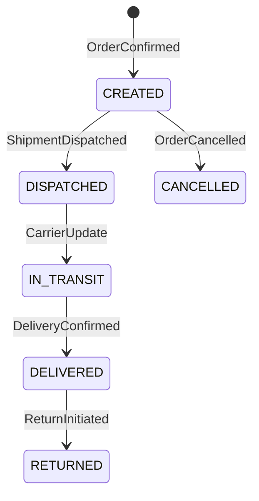
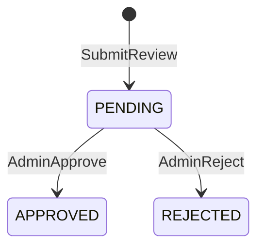

# eCommerce Bookstore — Domain Model
> Generated via Prompt 2 | DDD Event Storming | Source: spec/requirements.md

---

## 1. Bounded Contexts

---

## 2. Bounded Contexts Detail

| Bounded Context | Responsibility                                             | Key Aggregates                  |
|-----------------|------------------------------------------------------------|---------------------------------|
| Identity & Access (IAM) | Authentication, authorisation, user lifecycle   | User, Role                      |
| Catalog         | Books, browsing, search, related items                     | Book, Category, Author, Publisher |
| Shopping        | Wishlist and cart management                               | Cart, Wishlist                  |
| Order           | Checkout, order lifecycle, address                         | Order, Address                  |
| Payment         | Payment processing, wallet, refunds                        | Payment, Wallet                 |
| Shipping        | Rate calculation, delivery, returns                        | Shipment, ShippingRate          |
| Promotion       | Coupons, gift points, discounts                            | Coupon, GiftPoint               |
| Recommendation  | Personalised book suggestions                              | Recommendation                  |
| Review          | Customer ratings and comments                              | Review                          |

---

## 3. Aggregates

### IAM Bounded Context
| Aggregate | Root Entity | Children          |
|-----------|-------------|-------------------|
| User      | User        | Role, Address     |

### Catalog Bounded Context
| Aggregate | Root Entity | Children                      |
|-----------|-------------|-------------------------------|
| Book      | Book        | BookAuthor, BookCategory      |
| Category  | Category    | —                             |
| Author    | Author      | —                             |
| Publisher | Publisher   | —                             |

### Shopping Bounded Context
| Aggregate | Root Entity | Children    |
|-----------|-------------|-------------|
| Cart      | Cart        | CartItem    |
| Wishlist  | Wishlist    | WishlistItem|

### Order Bounded Context
| Aggregate | Root Entity | Children              |
|-----------|-------------|-----------------------|
| Order     | Order       | OrderItem, Address    |

### Payment Bounded Context
| Aggregate | Root Entity | Children              |
|-----------|-------------|-----------------------|
| Payment   | Payment     | PaymentMethod         |
| Wallet    | Wallet      | WalletTransaction     |

### Shipping Bounded Context
| Aggregate | Root Entity | Children          |
|-----------|-------------|-------------------|
| Shipment  | Shipment    | ShipmentTracking  |

### Promotion Bounded Context
| Aggregate  | Root Entity | Children  |
|------------|-------------|-----------|
| Coupon     | Coupon      | —         |
| GiftPoint  | GiftPoint   | —         |

---

## 4. Entities

| Entity            | Bounded Context | Key Attributes                                                        |
|-------------------|-----------------|-----------------------------------------------------------------------|
| User              | IAM             | id, email, passwordHash, firstName, lastName, role, isActive          |
| Role              | IAM             | id, name (GUEST/CUSTOMER/ADMIN)                                       |
| Address           | IAM             | id, userId, line1, line2, city, state, country, pincode, isDefault    |
| Book              | Catalog         | id, title, isbn, publisherId, price, stock, coverImageUrl, deliveryDays |
| Category          | Catalog         | id, name, parentCategoryId, slug                                      |
| Author            | Catalog         | id, name, bio, profileImageUrl                                        |
| Publisher         | Catalog         | id, name, country                                                     |
| Cart              | Shopping        | id, userId, status (ACTIVE/MERGED/ABANDONED)                          |
| CartItem          | Shopping        | id, cartId, bookId, quantity, unitPrice                               |
| Wishlist          | Shopping        | id, userId                                                            |
| WishlistItem      | Shopping        | id, wishlistId, bookId, addedAt                                       |
| Order             | Order           | id, userId, addressId, status, totalAmount, placedAt, cancelDeadline  |
| OrderItem         | Order           | id, orderId, bookId, quantity, unitPrice, deliveryDate                |
| Payment           | Payment         | id, orderId, method, status, amount, transactionRef, paidAt           |
| Wallet            | Payment         | id, userId, balance                                                   |
| WalletTransaction | Payment         | id, walletId, type (CREDIT/DEBIT), amount, referenceId                |
| Coupon            | Promotion       | id, code, discountType, discountValue, minOrderValue, expiresAt, isActive |
| GiftPoint         | Promotion       | id, userId, points, expiresAt                                         |
| Shipment          | Shipping        | id, orderId, carrier, trackingNumber, status, estimatedDelivery       |
| ShippingRate      | Shipping        | id, weightFrom, weightTo, zone, rate                                  |
| Review            | Review          | id, userId, bookId, rating (1–5), comment, status (PENDING/APPROVED)  |
| Recommendation    | Recommendation  | id, userId, bookId, score, reason                                     |

---

## 5. Value Objects

| Value Object    | Used In         | Attributes                                  |
|-----------------|-----------------|---------------------------------------------|
| Money           | Book, Order     | amount (BigDecimal), currency (ISO 4217)    |
| ISBN            | Book            | value (ISBN-13 string), validated format    |
| Rating          | Review          | value (1–5 integer)                         |
| DeliveryWindow  | OrderItem       | estimatedDays (int), dispatchDate (LocalDate)|
| DiscountValue   | Coupon          | type (PERCENTAGE/FIXED), value (BigDecimal) |
| Address         | Order, Shipment | Snapshot of address at time of order        |

---

## 6. Domain Events

| Event                    | Raised By       | Consumed By                        |
|--------------------------|-----------------|------------------------------------|
| UserRegistered           | IAM             | Recommendation (seed profile)      |
| UserLoggedIn             | IAM             | —                                  |
| BookAdded                | Catalog         | Recommendation                     |
| BookUpdated              | Catalog         | —                                  |
| CartItemAdded            | Shopping        | Recommendation                     |
| CartCheckedOut           | Shopping        | Order                              |
| OrderPlaced              | Order           | Payment, Shipping, Recommendation  |
| OrderCancelled           | Order           | Payment (refund), Shipping (cancel)|
| OrderReturned            | Order           | Payment (refund), Shipping (return)|
| PaymentProcessed         | Payment         | Order (confirm), Shipping (trigger)|
| PaymentFailed            | Payment         | Order (hold)                       |
| ShipmentDispatched       | Shipping        | Order (update status)              |
| ShipmentDelivered        | Shipping        | Order (complete), Review (unlock)  |
| CouponApplied            | Promotion       | Order (discount)                   |
| GiftPointsRedeemed       | Promotion       | Order (discount)                   |
| ReviewSubmitted          | Review          | Catalog (update avg rating)        |
| ReviewApproved           | Review          | —                                  |

---

## 7. Commands

| Command                  | Handled By      | Triggered By     |
|--------------------------|-----------------|------------------|
| RegisterUser             | IAM             | Guest            |
| LoginUser                | IAM             | User             |
| LogoutUser               | IAM             | Customer         |
| AddBook                  | Catalog         | Admin            |
| UpdateBook               | Catalog         | Admin            |
| DeleteBook               | Catalog         | Admin            |
| AddToCart                | Shopping        | Customer         |
| UpdateCartItem           | Shopping        | Customer         |
| RemoveFromCart           | Shopping        | Customer         |
| AddToWishlist            | Shopping        | Customer         |
| RemoveFromWishlist       | Shopping        | Customer         |
| PlaceOrder               | Order           | Customer         |
| CancelOrder              | Order           | Customer (≤48hr) |
| ReturnOrder              | Order           | Customer         |
| ProcessPayment           | Payment         | Order            |
| RefundPayment            | Payment         | Order            |
| TopUpWallet              | Payment         | Customer         |
| ApplyCoupon              | Promotion       | Customer         |
| RedeemGiftPoints         | Promotion       | Customer         |
| CreateShipment           | Shipping        | Payment          |
| SubmitReview             | Review          | Customer         |
| ApproveReview            | Review          | Admin            |

---

## 8. Read Models

| Read Model               | Purpose                                           | Updated By               |
|--------------------------|---------------------------------------------------|--------------------------|
| BookSummary              | Catalog listing (title, price, cover, rating)     | BookAdded, BookUpdated   |
| BookDetail               | Full book page with reviews and related books     | ReviewApproved           |
| CategoryTree             | Hierarchical category navigation                  | Admin                    |
| CartView                 | Cart contents with totals and recommendations     | CartItemAdded/Removed    |
| OrderSummary             | Order history list                                | OrderPlaced              |
| OrderDetail              | Full order with items, payment, shipment status   | Multiple events          |
| WishlistView             | Customer's saved books                            | Wishlist commands        |
| RecommendationFeed       | Personalised book list per user                   | OrderPlaced, CartItemAdded|
| ShipmentTracking         | Live delivery status per order                    | Shipment events          |

---

## 9. Relationships

---

## 10. State Transitions

### Order Status

### Payment Status

### Shipment Status

### Review Status

